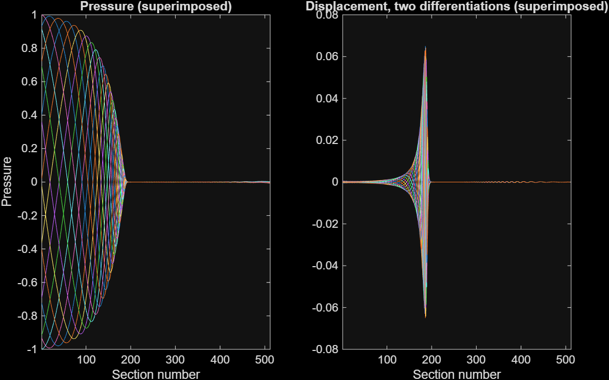

# Cochlear Filter-Bank Model

A discrete-time model of the human cochlea in MATLAB. Sound enters at the base and travels down a cascade of 512 filter sections. Each section is tuned to a lower frequency than the one before it, so every tone peaks at its own place along the membrane, just as in the real ear (the tonotopic map).

## How to run

Open `cochlear_model.m` in MATLAB (R2020a or later, for `exportgraphics`) and run it. It produces seven figures and saves them to `figures/`. To test another tone, change `f0` in the "Sinusoid input" section.

## How it works

**Frequency map.** The membrane (3.5 cm) is split into 512 sections. Section *m* is tuned to `fp = 7500 · 10^(-0.667x)` Hz, which spans about 7.5 kHz at the base down to 35 Hz at the apex.

**Each section has two second-order filters:**
- A **resonator** (complex pole pair, Q = 8) gives the membrane displacement at that point.
- A **notch** (complex zero pair, Q = 16, placed just below the previous section's resonance) gives the pressure passed on to the next section. The notch is what makes the response cut off sharply past the tuned frequency.

Pole and zero radii come from the bandwidth (`r = 1 − π·BW/fs`) and angles from the centre frequency (`θ = 2πf/fs`). Both filters are normalised to unity gain at DC. The sample rate is 16 kHz.

**Spatial differentiation.** The raw displacement is broad. Taking the difference between neighbouring sections, twice (`e_m = d_m − d_{m+1}`, where `d_m = s_m − s_{m+1}`), suppresses the slow low-frequency tail and sharpens tuning. This is a simple model of the extra sharpening the ear gets from outer hair cells.

## Results

| | Peak section | Width at half-max |
|---|---|---|
| Raw displacement | ~133 | ~184 sections |
| After two differentiations | ~186 | ~14 sections |

For a 1 kHz tone, two stages of spatial differentiation narrow the response by about 92% and move the peak to section ~186, close to section 192, which is tuned to 1.01 kHz.

### Validation

**Three-tone separation.** A mixture of 300 Hz, 1 kHz and 4 kHz tones is fed in together. After two stages of spatial differentiation, the response separates into three distinct peaks at sections ~54, ~186 and ~301, each near the section tuned to that frequency (61, 193 and 308). The model works as a spectrum analyser in space, like the real cochlea.

**Filter-bank coverage.** Magnitude responses of ten sections spread from base to apex show that the bank covers the full range. Differentiation turns each broad low-pass response into a sharp band-pass one.

**Tone offset.** The 1 kHz tone is switched off halfway through the signal while the other two continue. The 1 kHz place (section 186) decays by about 99% within ~14 ms (~220 samples), while the 300 Hz and 4 kHz places are unaffected. Each place responds only to its own frequency, and the model tracks changes in the input over time.

| Figure | Shows |
|---|---|
| `impulse_responses.png` | Impulse response at a high, middle and low-frequency section, before and after differentiation |
| `magnitude_response_1kHz.png` | FFT magnitude response of section 192: flat low-pass before, band-pass after |
| `tone_snapshot_1kHz.png` | Membrane displacement at one instant for a 1 kHz tone |
| `travelling_wave_envelope.png` | 16 instants (one full period) superimposed, showing the envelope |
| `three_tone_separation.png` | 300 Hz + 1 kHz + 4 kHz input, before and after one and two differentiation stages |
| `filterbank_responses.png` | Magnitude responses of ten sections from base to apex, before and after differentiation |
| `tone_offset_response.png` | Response at each tone's place when the 1 kHz tone is switched off at sample 1500 |

## Design choices

- **Cascade, not parallel.** Each section's input is the previous section's output, so a wave physically travels along the model and builds up delay, like the real cochlea.
- **Q_z = 2·Q_p.** A narrower notch than resonator gives a steep high-frequency cutoff without killing the passband.
- **Notch at 0.985 × the previous section's resonance.** This puts each zero just below the section above it, so energy at a given frequency stops propagating right after it peaks.
- **1-second impulse.** Low-frequency (apex) sections ring for thousands of samples, so the signal has to be long enough for them to decay before taking the FFT.
